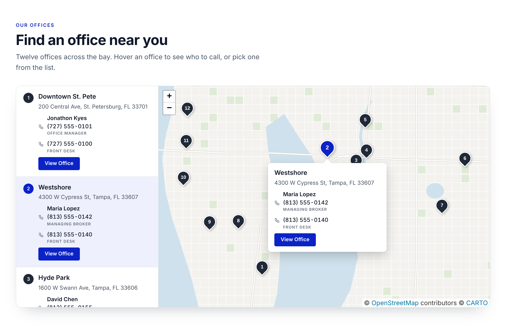
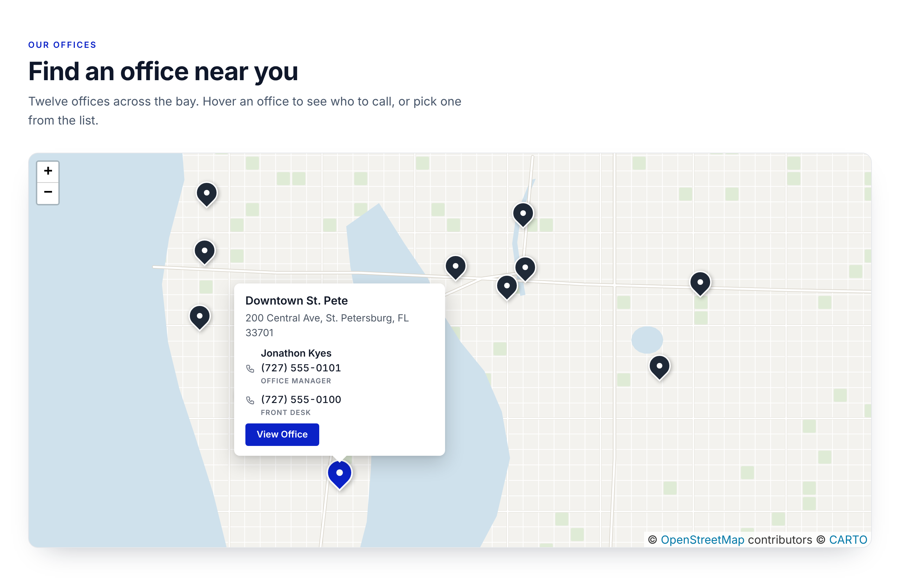
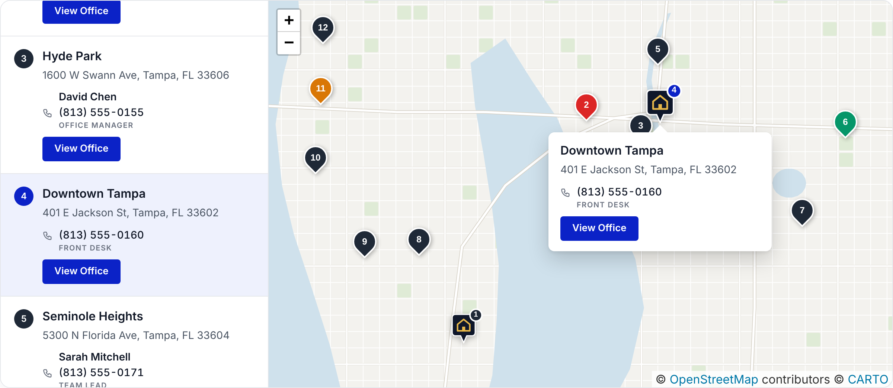
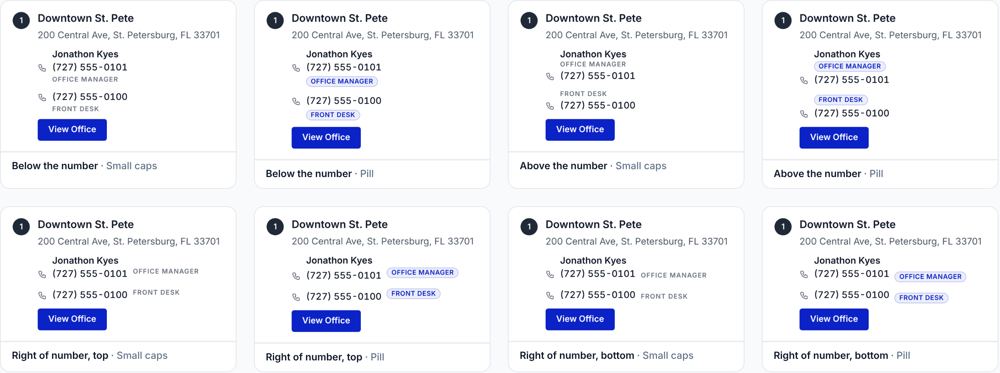
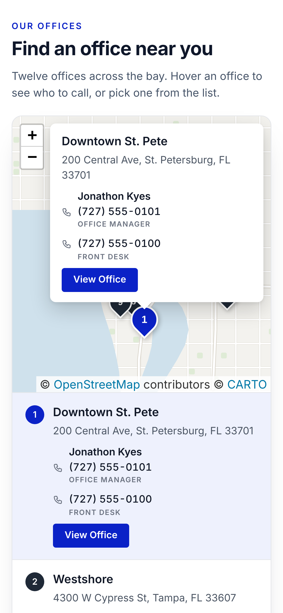

<div align="center">

# AVE Multi-Location Map for Elementor

**Show every office on one map. Unlimited pins, a hover popup or a synced office list,<br>labelled phone numbers, and your own pin colours or logo.**

[](https://github.com/ferozsaha100/Multi-location-map-widget/releases/latest)
[](https://github.com/ferozsaha100/Multi-location-map-widget/actions/workflows/tests.yml)

-92003B?logo=elementor&logoColor=white)

[](LICENSE)

[**Download the plugin**](https://github.com/ferozsaha100/Multi-location-map-widget/releases/latest) · [Quick start](#quick-start) · [Documentation](#using-the-office-map-widget) · [FAQ](#faq--troubleshooting) · [Changelog](CHANGELOG.md)

<br>



</div>

---

Built by [Agent View Digital](https://agentviewdigital.com) for real estate brokerages, teams and any business with more than a handful of locations. Add your offices in Elementor, click **Find all missing pins** once, and the map is done: no per-visitor geocoding, no pin limit, no Google billing required.

## Contents

- [Features](#features)
- [Screenshots](#screenshots)
- [Requirements](#requirements)
- [Installation](#installation)
- [Quick start](#quick-start)
- [Map keys](#map-keys)
- [Using the Office Map widget](#using-the-office-map-widget)
- [Settings reference](#settings-reference)
- [FAQ & troubleshooting](#faq--troubleshooting)
- [Privacy & third-party services](#privacy--third-party-services)
- [For developers](#for-developers)
- [The original Multi-Location Map widget](#the-original-multi-location-map-widget)
- [Contributing & support](#contributing--support)
- [Credits & license](#credits--license)

## Features

| Feature | What it does |
|---|---|
| **Unlimited pins** | Every address is looked up **once, in the editor**, and saved as latitude/longitude. Visitors never trigger a lookup, so 12 or 120 offices load equally fast. |
| **Two layouts** | **Layout 1**: full-width map, popup on hover (tap on phones). **Layout 2**: office list beside the map with numbered pins; hover or click either side and the other follows. |
| **Two map engines, per widget** | **Leaflet + CARTO** (free; Light, Voyager, Dark) or **Google Maps** (Standard, Silver, Dark). Pins look identical on both. |
| **People & phone numbers** | Any number of entries per office: *name*, *number* (tap-to-call) and *role* label, e.g. `Jonathon Kyes \| Office Manager \| (727) 555-0101`. Four label positions, pill or small-caps style. |
| **Per-office pins** | Give any office its own pin colour (global kit colours work) or upload its logo as the pin. Everything else follows the global style. |
| **Mobile-first details** | The list stacks under the map on phones; a tapped office pans the map so its full popup and pin are visible, clear of the zoom buttons. |
| **Lightweight** | Leaflet is bundled (no CDN). Map scripts load only when the map scrolls into view, and only on pages that use the widget. |
| **Accessible** | Pins are real buttons. Keyboard focus opens a popup, <kbd>Esc</kbd> closes it, `prefers-reduced-motion` is respected, and list text is crawlable HTML. |
| **Helpful editor notes** | An editor-only box tells you which offices still need a pin, or which key is missing. Visitors never see it. |

## Screenshots

<table>
<tr>
<td width="50%" valign="top">

<p align="center"><b>Layout 1</b>: pins with a hover popup</p>
</td>
<td width="50%" valign="top">

<p align="center"><b>Per-office pins</b>: own colours and uploaded logos</p>
</td>
</tr>
<tr>
<td colspan="2" valign="top">

<p align="center"><b>Phone numbers</b>: name, number and role, with 4 label positions × 2 styles</p>
</td>
</tr>
<tr>
<td colspan="2" align="center" valign="top">

<p align="center"><b>On phones</b>: the list stacks under the map, and a tapped office's popup always fits</p>
</td>
</tr>
</table>

<sub>Screenshots show fictional offices on a stylised demo basemap. On your site the map uses CARTO or Google Maps tiles.</sub>

## Requirements

| Requirement | Minimum |
|---|---|
| WordPress | 6.0 |
| PHP | 7.4 |
| Elementor | 3.5 (the free version is enough; Pro is not required) |
| Map key | A free [CARTO basemaps key](https://carto.com/basemaps/apikey) **or** a [Google Maps JavaScript API key](https://console.cloud.google.com/google/maps-apis/credentials) |

## Installation

1. Go to the [**latest release**](https://github.com/ferozsaha100/Multi-location-map-widget/releases/latest) and download **`ave-multi-location-map-x.y.z.zip`** from *Assets*.
   > Use the release zip, not GitHub's green **Code → Download ZIP** button. That one contains the whole repository (docs, tests) in a differently named folder.
2. In WordPress, go to **Plugins → Add New → Upload Plugin**, choose the zip and click **Install Now**.
3. Click **Activate**.

**Updating:** upload the newer zip the same way and choose **Replace current with uploaded**. Your maps and settings are kept.

## Quick start

1. **Add a map key.** Open **Settings → AVE Maps** and paste a [CARTO key](#carto-free-default) (or a [Google key](#google-maps) if you prefer Google).
2. **Add the widget.** In Elementor, search for **Office Map** (category *Agent View*) and drag it onto the page.
3. **Add your offices.** Under **Content → Offices**, add a row per office: name, address, phone numbers and button link.
4. **Find the pins.** Click **Find all missing pins**. Each address is looked up with OpenStreetMap, about one per second, and saved.
5. **Choose a layout and style**, then **Update** the page.

That's it. The map fits itself around every office.

## Map keys

Keys are entered **once per site** under **Settings → AVE Maps**, and each widget picks its engine.

### CARTO (free, default)

The Leaflet engine uses [CARTO basemaps](https://carto.com/basemaps/): clean Light, colourful Voyager and Dark styles.

- Get a free key at **[carto.com/basemaps/apikey](https://carto.com/basemaps/apikey)**. No CARTO account is needed.
- Use **one key per website**.
- CARTO stopped serving tiles without a key on 25 September 2026. Without a key the widget hides the map rather than showing a broken one, and Layout 2 still shows the office list.
- The "© OpenStreetMap © CARTO" credit must stay visible, and the widget shows it automatically.

### Google Maps

1. In [Google Cloud Console](https://console.cloud.google.com/google/maps-apis/credentials), enable **Maps JavaScript API** (billing must be enabled on the project).
2. Create an API key and restrict it to your site under *Website restrictions*, e.g. `https://example.com/*`.
3. Paste it into **Settings → AVE Maps → Google Maps API key** and set the widget's **Map engine** to *Google Maps*.

> The Geocoding API is **not** needed. Addresses are looked up with OpenStreetMap in the editor.

**Using Agent View Extension too?** If its map settings already hold these keys, this plugin uses them automatically.

## Using the Office Map widget

### Office fields

Each row under **Content → Offices**:

| Field | Notes |
|---|---|
| **Office name** | Shown in the popup and the list. |
| **Address** | Shown as text, and used by *Find on map*. |
| **Phone numbers** | One per line. See [Phone numbers](#phone-numbers). |
| **Find on map** | Looks up this row's address and fills Latitude/Longitude. |
| **Latitude / Longitude** | Filled automatically and editable to fine-tune a pin. Offices without coordinates are hidden, and the editor tells you which ones. |
| **Pin for this office** | Optional **Pin colour** and **Custom pin icon / logo**. See [Per-office pins](#per-office-pins). |
| **Button link / Button text** | The button appears only when a link is set. Supports new tab and nofollow. |

Below the list, **Find all missing pins** looks up every office that has an address but no coordinates yet. A status line shows progress (*Finding 12 of 45…*) and lists any address OpenStreetMap couldn't find.

> **Tip:** if an address isn't found (very new streets, unusual suite formats), right-click the spot in Google Maps, copy the coordinates, and paste them into Latitude/Longitude.

### Phone numbers

Type one entry per line. A pipe `|` separates the parts, and the part with the digits is always the number, so the order is forgiving:

```text
Jonathon Kyes | Office Manager | (727) 555-0101
Front Desk | (727) 555-0100
(727) 555-0102
```

| You type | Shows as |
|---|---|
| `Name \| Role \| Number` | **Name** above the number, *role* as the small label |
| `Role \| Number` (or `Role: Number`) | Number with a role label |
| `Number` | Just the number |
| `Ana Ruiz \|  \| 555-0100` | Name and number, no role (leave the slot empty) |
| `(727) 555-0102 ext. 12` | Tap-to-call dials the extension after a pause |

Up to 10 numbers per office. **Content → Phone numbers** sets the role label position (*below*, *above*, *right of number top/bottom*), its style (*small caps text* or *pill*) and the phone icon.

### Per-office pins

Every pin uses the colours in **Style → Pins** unless an office says otherwise. Open the office and use **Pin for this office**:

- **Pin colour**: that office only. Global kit colours work. When highlighted, the pin keeps its own colour (a shade darker and slightly larger), and its Layout 2 list number matches.
- **Custom pin icon / logo**: upload a PNG or SVG (transparent background works best). It replaces the pin, with the bottom centre of the image on the location. All logos share **Style → Pins → Custom icon height** (default 40px), and their width follows the image. In Layout 2, a small number badge sits on the logo's corner.

> SVG uploads require *Elementor → Settings → Advanced → Enable Unfiltered File Uploads*. PNG always works.

### Layouts

| | Layout 1: pins with hover popup | Layout 2: office list + pins |
|---|---|---|
| Best for | Contact sections, compact maps | "Our offices" pages, many locations |
| Desktop | Hover a pin for its popup; the popup stays open while you move onto its button | Hover or click an office or pin; the other side highlights and the list scrolls to it |
| Phones | Tap a pin; the map pans so the whole popup is visible | List stacks under the map; tap an office to show it on the map |
| Numbers | n/a | Separate show/hide for **numbers on pins** and **numbers in the list** |

## Settings reference

<details>
<summary><b>Content tab</b></summary>

| Section | Setting | Default |
|---|---|---|
| Layout | Layout | Layout 1: pins with hover popup |
| | Numbers on pins *(Layout 2)* | Show |
| | Numbers in office list *(Layout 2)* | Show |
| Offices | Offices (repeater), **Find all missing pins** | n/a |
| Phone numbers | Role label position | Below number |
| | Role label style | Small caps text |
| | Phone icon | On |
| Map settings | Map engine | Leaflet + CARTO |
| | Map style | Light (CARTO) / Standard (Google) |
| | Closest zoom when fitting pins | 15 |
| | Zoom buttons | On |
| | Mouse-wheel zoom | Off (the page scrolls past the map) |

</details>

<details>
<summary><b>Style tab</b></summary>

| Section | Controls |
|---|---|
| Map | Height (responsive; 520px desktop, 380px mobile), border, border radius |
| Pins | Pin colour, highlighted pin colour, number/dot colour, pin size, custom icon height |
| Popup | Background, width (300px), name and address colour and typography, padding, radius |
| Phone numbers | Name, number (normal and hover), role label and pill colours and typography; icon colour; spacing |
| Button | Typography, text and background (normal and hover), padding, radius |
| Office list *(Layout 2)* | List width (340px), background, highlighted office background, divider, padding, name and address colour and typography |

</details>

## FAQ & troubleshooting

<details>
<summary><b>Is there really no limit on the number of pins?</b></summary>

Correct. Coordinates are saved in the widget, so the live page draws pins without asking any geocoding service. The test suite runs with 45 and 120 offices.
</details>

<details>
<summary><b>The map is blank or hidden on the live site.</b></summary>

- **Leaflet + CARTO**: add a CARTO key under *Settings → AVE Maps*. Without one, the map is hidden on purpose.
- **Google Maps**: check the browser console. "Google Maps rejected the API key" means the Maps JavaScript API isn't enabled, billing is off, or the key's website restriction doesn't include your domain.
- Open the page in the Elementor editor: the yellow editor-only box names the problem.
</details>

<details>
<summary><b>"Find on map" can't find an address.</b></summary>

OpenStreetMap may not know very new streets. The lookup already retries without *Suite / Ste / Unit / #*. If it still fails, paste coordinates from Google Maps (right-click → copy) into Latitude/Longitude.
</details>

<details>
<summary><b>"OpenStreetMap is limiting requests from this server."</b></summary>

The public Nominatim service allows about one request per second per site, and the plugin already spaces requests 1.1 s apart. Wait a minute and click *Find all missing pins* again; offices that already have pins are skipped.
</details>

<details>
<summary><b>Do I need Elementor Pro?</b></summary>

No. The widget works with free Elementor 3.5+.
</details>

<details>
<summary><b>Will updating change my existing maps?</b></summary>

Your offices and settings are kept. New options default to the previous look; the one release that changed a default (2.2.0, phone label position and style) says so in the [changelog](CHANGELOG.md). Update by uploading the new release zip and choosing *Replace current with uploaded*.
</details>

## Privacy & third-party services

| Service | When | What is sent |
|---|---|---|
| [OpenStreetMap Nominatim](https://nominatim.org/) | **Editor only**, when you click *Find on map* or *Find all missing pins*. Requests come from your server, not visitors. | The office address, your site URL, and the contact email from *Settings → AVE Maps* (required by the [usage policy](https://operations.osmfoundation.org/policies/nominatim/)). Results are cached. |
| [CARTO basemaps](https://carto.com/) | Visitors viewing a map using the Leaflet engine | The visitor's browser loads map tiles from CARTO, which sees the visitor's IP address and the tile requested. |
| [Google Maps](https://cloud.google.com/maps-platform/terms) | Visitors viewing a map using the Google engine | Standard Google Maps JavaScript API traffic from the visitor's browser |

Leaflet is bundled with the plugin, so no third-party JavaScript CDN is used. Mention the map provider in your site's privacy policy, and in your cookie/consent tool if your jurisdiction requires it.

## For developers

<details>
<summary><b>Filters</b></summary>

| Filter | Default | Purpose |
|---|---|---|
| `ave_mlm_nominatim_params` | `[ 'format' => 'jsonv2', 'limit' => 1, 'addressdetails' => 0 ]` | Extra Nominatim query parameters, e.g. `countrycodes`. |
| `ave_mlm_nominatim_interval` | `1.1` | Seconds between Nominatim requests. Don't go below 1. |
| `ave_mlm_geocode_api_key` | widget/constant key | *Original widget*: server-side Google Geocoding key. |
| `ave_mlm_geocode_time_budget` | `10.0` | *Original widget*: seconds per render for uncached lookups. |
| `ave_mlm_geocode_request_params` | `[]` | *Original widget*: extra Google Geocoding parameters, e.g. `[ 'region' => 'us' ]`. |

```php
// Prefer US results for "Find on map".
add_filter( 'ave_mlm_nominatim_params', function ( $params ) {
	$params['countrycodes'] = 'us';
	return $params;
} );
```
</details>

<details>
<summary><b>REST endpoint, JavaScript and CSS hooks</b></summary>

- **REST:** `POST /wp-json/ave-mlm/v1/geocode` with `{ "address": "…" }` returns `{ lat, lng, label, cached }`. It requires the `edit_posts` capability and a `wp_rest` nonce. Only the editor uses it; nothing public is exposed.
- **JavaScript:** maps initialise on `DOMContentLoaded` and on Elementor's `frontend/element_ready/ave-office-map.default`. For maps inserted later (AJAX, popups), call `window.aveOfficeMapInit()`.
- **CSS custom properties** on `.ave-om`: `--ave-om-height`, `--ave-om-pin`, `--ave-om-pin-active`, `--ave-om-pin-text`, `--ave-om-pin-size`, `--ave-om-icon-size`, `--ave-om-popup-bg`, `--ave-om-popup-width`, `--ave-om-popup-radius`, `--ave-om-list-width`, `--ave-om-divider`, `--ave-om-item-active-bg`, `--ave-om-label-text`, `--ave-om-pill-bg`, `--ave-om-phone-icon`, `--ave-om-phone-gap`.
</details>

<details>
<summary><b>Project structure & tests</b></summary>

```text
ave-multi-location-map/      ← the plugin (this folder is what the release zip contains)
├── ave-multi-location-map.php
├── includes/                settings page, Nominatim client, REST endpoint, legacy geocoder
├── widgets/                 Office Map + original Multi-Location Map widgets
└── assets/                  runtime + editor JS, CSS, bundled Leaflet 1.9.4
docs/screenshots/            README images
tests/                       PHP, editor-JS and real-browser (Playwright) suites
```

The suites stub WordPress and Elementor, so you don't need a WordPress install:

```bash
bash tests/run.sh --no-browser                    # PHP 7.4+ and Node 18+
npm install --prefix tests && npx --prefix tests playwright install chromium
bash tests/run.sh                                 # + Chromium tests (Leaflet, layouts, phones, pins, mobile)
```

GitHub Actions runs them on every push (PHP 7.4 and 8.3). Releases are built by the *Release* workflow: push a tag such as `v2.4.2`, or use **Actions → Release → Run workflow**. See [CONTRIBUTING.md](CONTRIBUTING.md#releasing-maintainers).
</details>

## The original Multi-Location Map widget

Version 1.x shipped a Google-only **Multi-Location Map** widget that looks up addresses on page view. It's still included and unchanged, so existing pages keep working. For new maps, use **Office Map**.

## Contributing & support

- **Bugs and feature requests:** [open an issue](https://github.com/ferozsaha100/Multi-location-map-widget/issues/new/choose).
- **Pull requests** are welcome. See [CONTRIBUTING.md](CONTRIBUTING.md).
- **Security issues:** please follow [SECURITY.md](SECURITY.md) rather than opening a public issue.
- **Custom real estate websites, IDX/MLS integration or setup help:** [Agent View Digital](https://agentviewdigital.com).

## Credits & license

- [Leaflet](https://leafletjs.com/) 1.9.4, © 2010–2023 Volodymyr Agafonkin, © 2010–2011 CloudMade, BSD-2-Clause (bundled, see `ave-multi-location-map/assets/vendor/leaflet/1.9.4/LICENSE`)
- Phone icon from [Tabler Icons](https://tabler.io/icons) (MIT)
- Map data © [OpenStreetMap](https://www.openstreetmap.org/copyright) contributors (ODbL); basemaps © [CARTO](https://carto.com/attributions)

**AVE Multi-Location Map** is free software, released under the [GNU General Public License v2.0 or later](LICENSE).
© [Agent View Digital](https://agentviewdigital.com)
